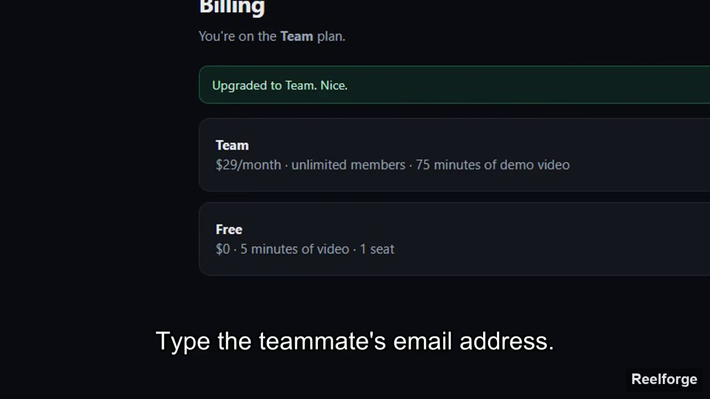
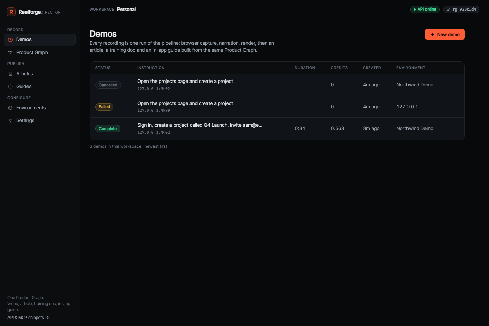

# Reelforge

**Give it a URL and one sentence. It drives your product in a real browser, records it, and publishes a narrated demo video, a help-centre article, an internal training doc and an in-app guide — all from one Product Graph.**

An open-source, self-hosted alternative to commercial demo agents ([Screenforge Director](https://director.screenforge.co) is the one it was reverse-engineered from — see [docs/ARCHITECTURE.md](docs/ARCHITECTURE.md)). **Bring your own model key, or run it completely offline.** No account, no per-seat pricing, no vendor holding your screen recordings.

**Free forever:** MIT licence, no paid tier, no export caps, no seat limits, no telemetry, and the watermark is a render option you control rather than a licence gate.

[](https://github.com/Majeed-GitHub/reelforge/actions/workflows/ci.yml)
[](LICENSE)
[](package.json)
[](docs/DEPLOY.md)
[](docs/MCP.md)

**Website:** [majeed-github.github.io/reelforge](https://majeed-github.github.io/reelforge/) · **Promo:** [16:9](docs/media/reelforge-promo.mp4) · **Social:** [9:16 story](docs/media/reelforge-story-9x16.mp4) · [1:1 post](docs/media/reelforge-post-1x1.mp4) · [4:5 feed](docs/media/reelforge-feed-4x5.mp4) · **Report:** [PROJECT-REPORT.md](docs/PROJECT-REPORT.md)



---

## Try it in 60 seconds

```bash
git clone https://github.com/Majeed-GitHub/reelforge.git && cd reelforge
npm install
npx playwright install chromium     # once, ~130 MB
npm run seed                        # creates a workspace, prints an rg_… key
npm run dev
```

| | |
|---|---|
| Dashboard | <http://127.0.0.1:4401> — paste the key from `npm run seed` |
| Demo product | <http://127.0.0.1:4402> — "Northwind", a little SaaS to record |
| API + MCP | <http://127.0.0.1:4400/api> |

Then put in an instruction like *"Sign in, create a project called Q4 Launch, invite
sam@example.com, then upgrade to the Team plan"* and watch it work through the
product, narrate, and publish.

Or with Docker:

```bash
docker run --rm -p 4400:4400 -v reelforge-data:/data ghcr.io/Majeed-GitHub/reelforge:latest
```

No model key is required for either — see [Run fully local](#run-fully-local).

## How it works

```
URL + one sentence
      │
      ▼
 real Chromium  ──►  recorded run  ──►  narrated MP4 (auto-zoom · eased cursor · captions)
      │                    │
      │                    └────────►  Product Graph (screens · flows · controls)
      │                                        │
      │                                        ├─►  Help-centre article
      │                                        ├─►  Internal training doc
      │                                        ├─►  In-app guide (one <script> tag)
      │                                        └─►  GIF preview · share page · webhook
      ▼
 REST API + MCP server, so your coding agent can do all of it too
```

| Stage | What actually happens |
|---|---|
| **Plan** | Your instruction becomes browser actions. Any OpenAI-compatible model, or the offline scripted planner. |
| **Drive** | Playwright opens the product, signs in if needed, and acts. The cursor and click ripples are injected *into the page*, so they are already in the recording — no compositing pass. |
| **Capture** | Every step records timing, element box, selector, accessible name, a screenshot and a narration line. |
| **Render** | One ffmpeg pass: eased auto-zoom onto each action, burned captions, watermark, and a voiceover timed to the steps. |
| **Index** | The run is filed into the Product Graph — one flow per route, deduplicated by signature, with the controls each step used. |
| **Publish** | Video, article, training doc, guide, GIF and share page are all views of that one flow. Re-check a flow and it flags drift. |

## Bring your own key

The planner is a single `/chat/completions` call, so it works with almost anything.
Set it with env vars or paste a key in **Settings → Model provider**.

**31 providers, no configuration required if you already have a key.** Reelforge
auto-detects any conventional key in your environment (then probes local servers), so the
provider choice is optional.

| Tier | Providers |
|---|---|
| **Free / open tiers** (10) | Google Gemini, OpenRouter, Groq, Mistral, Cerebras, NVIDIA NIM, GitHub Models (free with a GitHub token), Hugging Face, SambaNova, Alibaba DashScope |
| **Paid** (15) | GMI Cloud, OpenAI, Anthropic, DeepSeek, xAI/Grok, Together, Fireworks, DeepInfra, Nebius, Novita, Hyperbolic, Moonshot, Zhipu/GLM, Perplexity, Azure OpenAI |
| **Local, no key** (6) | Ollama, LM Studio, llama.cpp, vLLM, LocalAI, and a Custom endpoint |

Provider quirks are data rather than code paths, so **Azure** (deployment URL, `api-key`
header, `api-version`) and **Anthropic** (native Messages API, translated) work like every
other card. AWS Bedrock and Google Vertex need SigV4/OAuth instead of a key, so they are
documented as unsupported with an OpenAI-compatible proxy workaround — not faked. Full
matrix: [docs/PROVIDERS.md](docs/PROVIDERS.md).

```bash
# example: GMI Cloud
export REELFORGE_LLM_PROVIDER=gmi
export GMI_API_KEY=...
export REELFORGE_LLM_MODEL=vendor/model-name
npm run api
```

Keys pasted in the dashboard are stored **AES-256-GCM encrypted**, scoped to the
workspace, and never returned by the API — only a masked hint (`sk-…4f2a`). Model
lists are discovered live from the provider. Full matrix and troubleshooting:
[docs/PROVIDERS.md](docs/PROVIDERS.md).

### Run fully local

No key, no network, no cost:

```bash
export REELFORGE_LLM_PROVIDER=none     # offline scripted planner
export REELFORGE_TTS_PROVIDER=sapi     # Windows SAPI narration (or `edge` for neural voices)
```

The scripted planner understands sign-in, navigation, create, invite and upgrade
flows and narrates them. It is the default with no configuration, which is why the
smoke test and CI never need credentials.

## What's in the box

| Component | What it does |
|---|---|
| **REST API** | 40+ endpoints mirroring Director's contract: `{message,data}` / `{code,message,remediation}`, polling job model, 7 documented error codes with `remediation.action`. |
| **MCP server** | Streamable HTTP at `POST /api/mcp` *and* a stdio bridge for Claude Desktop. 39+ tools, resources, prompts. |
| **Dashboard** | React: live progress, video player, transcript, Product Graph, articles, guides, environments, BYOK providers, webhooks. |
| **In-app guide** | 3.9 KB gzip embeddable widget, shadow-DOM isolated, skips steps whose target moved and reports them. |
| **Product Graph** | Flows deduplicated by signature, screens, controls, staleness detection on re-check. |
| **Outputs** | MP4, SRT/VTT captions, GIF preview, public share page, **interactive walkthrough** (one self-contained HTML file), **embeddable player** with privacy-respecting view counts, HMAC-signed webhooks (Slack-compatible). |
| **CLI** | `reelforge session` (capture an SSO/2FA sign-in without sharing the password), `mcp`, `init`, `doctor`. |
| **Metering** | Director-parity credits (1 credit = 1 finished minute, 15 s minimum), off by default when self-hosted. |



## Talk to it from an agent

```bash
# Claude Code, over HTTP
claude mcp add --transport http reelforge http://127.0.0.1:4400/api/mcp \
  --header "X-API-Key: rg_…"

# Claude Desktop, over stdio (bridges stdio -> the HTTP MCP server)
npm run mcp:stdio -- --api-key rg_…
```

Then just ask: *"Record a demo of signing up on http://127.0.0.1:4402 and publish a
help article from it."* See [docs/MCP.md](docs/MCP.md) for every tool.

### Editor plugins (10 KB of text, no dependencies)

| Host | Install | What you get |
|---|---|---|
| **Claude Code** | `claude --plugin-dir <repo>/plugins/claude-code` | `/record-demo`, `/publish-article`, `/demo-status` |
| **OpenCode** | copy `plugins/opencode/opencode.json` into your config | the MCP server plus a no-op guard plugin |
| **DeepSeek Harness** | copy `plugins/deepseek/SKILL.md` to `~/.agents/skills/reelforge/` | a skill that triggers on "record a demo" |

All three just point the agent at `POST /api/mcp`; the API must be running and
reachable from the agent process. See [docs/PLUGINS.md](docs/PLUGINS.md).

Plain REST works too:

```bash
curl -X POST http://127.0.0.1:4400/api/demos \
  -H "X-API-Key: $REELFORGE_API_KEY" -H 'content-type: application/json' \
  -d '{"target":{"type":"url","url":"https://app.example.com"},
       "instruction":"Create a project, then invite a teammate.",
       "authorized":true,"options":{"language":"en"}}'
# → { "data": { "id": "dem_…", "status": "queued", "pollAfterSeconds": 3 } }
```

## Verified, not promised

`npm run smoke` records a real 11-step demo and asserts **23 things** about it —
video bytes, dimensions, duration, transcript, graph flow, article body, guide
embeddability. On Windows 11 / Node 25.8 with **zero API keys**:

| | |
|---|---|
| Finished video | 862 KB, h264 1280×720 + AAC, 32.5 s, auto-zoom + captions |
| Steps | 11, each with box, click point, selector, screenshot, narration |
| Product Graph | 1 flow (`617d4a55e9fa0a75`), 6 screens |
| Article | 3 159 chars, 11 sections, signed screenshots |
| Guide | 10 resolvable steps, public embed key |
| Billed | 0.542 credits (32.549 s at 1 credit/minute) |

Full log, including the honest limitation list: [docs/VERIFICATION.md](docs/VERIFICATION.md).

Every suite is a real run, not a mock of the interesting parts:

```bash
npm test            # typecheck + MCP stdio bridge + dashboard browser suites
npm run smoke       # records, renders and publishes a demo end to end
npm run test:mcp    # stdio ↔ HTTP MCP bridge (8 checks, 39 tools proxied)
npm run test:ui     # dashboard: 22 legacy + 18 v0.2 browser checks
```

## Compared to Director

Same shape, different trade-offs — [docs/ARCHITECTURE.md](docs/ARCHITECTURE.md) documents exactly what was reverse-engineered and what was rebuilt from first principles.

| Director | Reelforge |
|---|---|
| Hosted SaaS, per-minute credits | Self-hosted, MIT, credits modelled but optional |
| Proprietary planner | Any OpenAI-compatible model, or fully offline |
| Cloud TTS | Offline SAPI / edge-tts fallback, no key needed |
| Cloud workers | Your machine; tunnels for local dev servers |

**What it does not do:** interactive click-through demos (use Supademo/Walnut/HowdyGo
for that), avatar videos, or passkey replay (origin+device bound — impossible for
any recorder).

## Docs

| | |
|---|---|
| [FEATURES.md](docs/FEATURES.md) | Every feature, what paid tools charge for it, and why some are missing |
| [CLIENT-GUIDE.md](docs/CLIENT-GUIDE.md) | A one-page, non-technical guide you can forward to a client |
| [ROADMAP.md](docs/ROADMAP.md) | An honest audit of what is still missing, and the order to do it |
| [EMBED.md](docs/EMBED.md) | Embedding a demo in your own site, player params, analytics, privacy |
| [PRIVACY-MODEL.md](docs/PRIVACY-MODEL.md) | What a recording can and cannot see, and the limits |
| [site/](site) | The marketing site (GitHub Pages, no build step) and the promo composition |
| [ARCHITECTURE.md](docs/ARCHITECTURE.md) | What was reverse-engineered, and how it is built |
| [VERIFICATION-V03.md](docs/VERIFICATION-V03.md) | v0.3 evidence: aspect ratios, ducking, redaction pixels, walkthrough |
| [VERIFICATION.md](docs/VERIFICATION.md) | Every check, every number, and the honest gaps |
| [API.md](docs/API.md) | REST surface, error codes, MCP tools |
| [PROVIDERS.md](docs/PROVIDERS.md) | BYOK matrix, local Ollama, key handling |
| [MCP.md](docs/MCP.md) | Agent setup for Claude Code / Desktop / Cursor |
| [OUTPUTS.md](docs/OUTPUTS.md) | Webhooks, share pages, GIF, captions |
| [DEPLOY.md](docs/DEPLOY.md) | Docker, bare metal, reverse proxy, backups |
| [CONTRIBUTING.md](CONTRIBUTING.md) | Dev setup and PR rules |
| [PROJECT-REPORT.md](docs/PROJECT-REPORT.md) | The written report: methodology, design decisions, results |

## Credits

Built by **Shaik Majeed**, developed with the **[DeepSeek Harness](https://github.com/deepseek-ai)**
using the **GMI Cloud API**. The API shape, error codes and CLI behaviour were
reimplemented for interoperability from public documentation and the published
`@screenforge/director-cli` npm package; no Screenforge code is included.

MIT licensed — use it, fork it, sell demos made with it.
